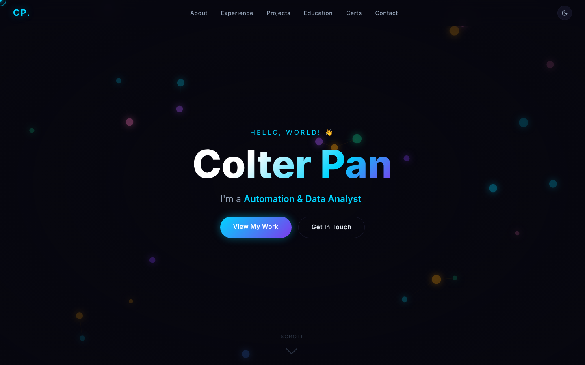
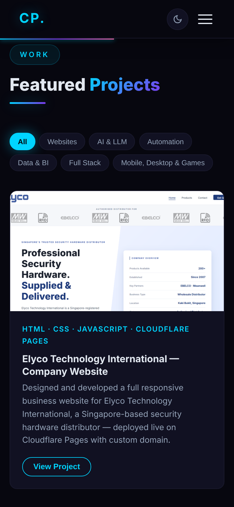
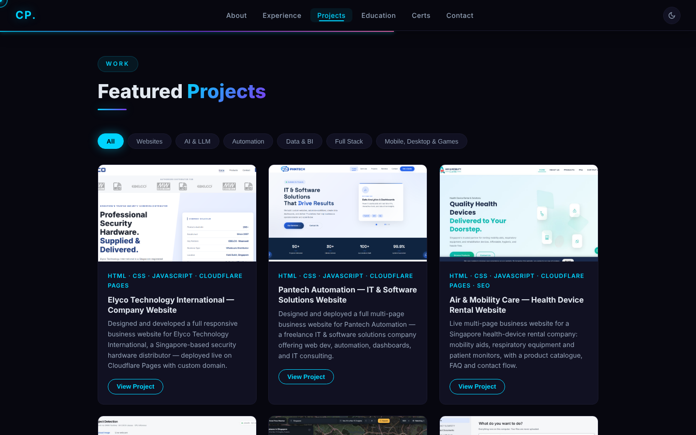

# Colter Pan: Portfolio Website

My personal portfolio site, live at **[colterpan.github.io](https://colterpan.github.io)**. It covers my experience, skills, 36 projects, education and certifications.

Built with plain HTML, CSS and JavaScript (no framework) and hosted on GitHub Pages. It includes a typing headline, an animated particle background, a draggable tech-stack globe and a light/dark theme toggle, and it is responsive down to phone size.

## Screenshots

<p align="center">
  
  
</p>

<p align="center">
  
</p>

## Projects

Each project card opens a details window with a screenshot gallery, the tools used, and links to the live site or the GitHub repo. Cards can be filtered by category: Websites, AI &amp; LLM, Automation, Data &amp; BI, Full Stack, and Mobile, Desktop &amp; Games.

Project screenshots live in `images/projects/` and were taken with demo or fictional data only.

## Run locally

```bash
python -m http.server 8000
```

Then open http://localhost:8000.
